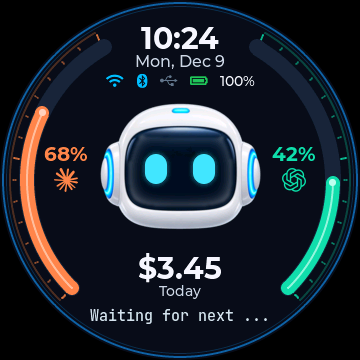

# Watchling


*Concept illustration based on the ESP-VoCat product reference and Watchling UI mockups. [Brand direction](docs/brand/README.md).*

A tiny desk companion for **Claude Code and Codex CLI**, built for the **ESP-VoCat V1.2** (formerly EchoEar). See agent activity and usage, hear task notifications, and answer permission requests on its touchscreen.

## What it does

- Shows Claude and Codex usage arcs, Claude's estimated daily cost, clock and connection status.
- Displays permission requests with touch **Approve / Deny** and falls back to the terminal if the device is unavailable or the request times out.
- Connects over USB or paired Bluetooth LE, preferring USB when available.
- Plays notification chimes and USB-only spoken announcements.
- Blinks, looks around, reacts to work, and plays prerecorded English chatter during quiet periods.
- Offers brightness, volume and Voice controls in a pull-down Settings screen.

| Dashboard | Settings |
| --- | --- |
|  |  |

*Host simulator captures of the firmware UI; not device photographs.*

## Supported setup

| Component | Requirement |
| --- | --- |
| Host | macOS; automatic bridge startup uses launchd and speech uses `say` |
| Hardware | ESP-VoCat V1.2, ESP32-S3, 16 MB flash / 16 MB octal PSRAM |
| Bridge | Node.js 22 or newer and npm |
| Firmware | ESP-IDF 5.5, ESP-VoCat BSP, LVGL 9.6 |
| Agents | Claude Code terminal integration; Codex CLI session files and optional permission hooks |

Normal operation needs **no Gemini or ElevenLabs API keys**. Those services are used only by developer tools to regenerate bundled audio. Linux and Windows host integration are not currently supported. Wi-Fi is not implemented; speech is unavailable over BLE.

## Get started

Download or clone this repository, then follow [the installation guide](docs/getting-started.md) to build and flash the firmware. From the repository root, prepare the bridge:

```sh
cd pc-bridge
nvm use
npm ci
npm run build
npm run list-ports
```

`nvm use` is optional if Node 22 or newer is already active. For a first USB-only run:

```sh
WATCHLING_BLE=off npm start
```

The dashboard should receive its clock and connection status. Stop the foreground bridge with Ctrl-C before enabling automatic startup. Install the integration for the agent you use:

```sh
npm run hooks:install          # Claude Code
npm run hooks:install:codex    # Codex CLI
```

These commands modify per-user agent settings, create backups and register a shared macOS launch agent. Read [what the installer changes](docs/getting-started.md#agent-integrations) first. Start a new agent session to start the bridge automatically.

## Daily use

A task completion triggers a chime and a short announcement. A permission request appears on the touchscreen while the terminal waits. Review the command or file summary before tapping a decision; use the terminal for questions that need a written answer. Unanswered requests return to the terminal after 120 seconds by default.

Pull down from the top of the display to open Settings. Brightness and volume use the two arcs; Voice mutes speech and chatter while leaving chimes enabled. Values persist on the device. After 30 seconds without interaction the face fills the display; after five quiet minutes it dozes. A tap or agent event brings the dashboard back.

To free USB for flashing, stop the bridge from `pc-bridge/`:

```sh
npm run bridge:stop
```

Exit any serial monitor as well. The next agent session can start the bridge again.

## Documentation

| Guide | Contents |
| --- | --- |
| [Getting started](docs/getting-started.md) | Firmware, first connection, agent setup and removal |
| [Hardware](docs/hardware.md) | Board, USB and Bluetooth pairing |
| [Configuration](docs/configuration.md) | Environment variables, state files and privacy |
| [Troubleshooting](docs/troubleshooting.md) | USB, BLE, hooks, audio and startup issues |
| [Chatter](docs/chatter.md) | Current timing, character and clip selection |
| [Architecture](docs/architecture.md) | Agent → bridge → USB/BLE → firmware |
| [Development](docs/development.md) | Checks, UI simulator and audio asset tools |
| [Device protocol](docs/device-protocol.md) | Framing, messages and permission rules |
| [Brand](docs/brand/README.md) | Identity, palette and image references |

## Project layout

| Path | Purpose |
| --- | --- |
| `echoear-firmware/` | ESP-IDF firmware and host UI simulator |
| `pc-bridge/` | TypeScript bridge, hooks, speech and bundled chatter clips |
| `scripts/idf-env.sh` | Loads an installed ESP-IDF environment |
| `docs/` | Maintained guides; historical proposals are in `docs/archive/` |
| `plans/` | Implementation history and decisions |

## Contributing and licensing

See [CONTRIBUTING.md](CONTRIBUTING.md) for the development workflow and [SECURITY.md](SECURITY.md) for security reports. Asset sources and licensing questions are recorded in [THIRD_PARTY_NOTICES.md](THIRD_PARTY_NOTICES.md). Check the repository's license status before redistributing code or assets.

The source license has not yet been selected. The remaining publication steps are tracked in
the [release checklist](docs/release-checklist.md).
