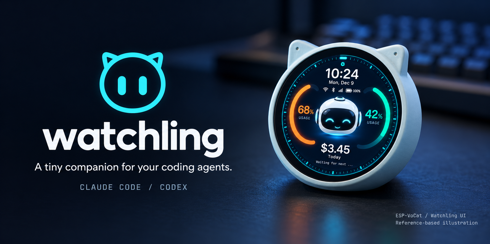
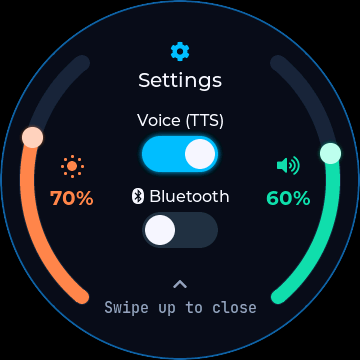
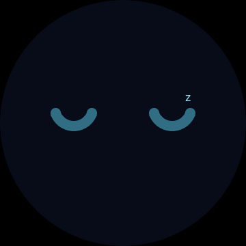
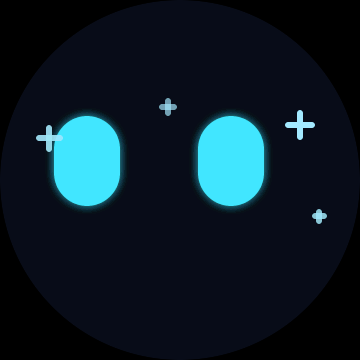

# Watchling



*Concept illustration based on the ESP-VoCat enclosure and Watchling UI.*

A tiny desk companion for **Claude Code and Codex CLI**, built for the **ESP-VoCat V1.2** (formerly EchoEar). See agent activity and usage, hear task notifications, and answer permission requests on its touchscreen.

## What it does

- Shows Claude and Codex usage arcs, Claude's estimated daily cost, clock and connection status.
- Displays permission requests with touch **Approve / Deny** and falls back to the terminal if the device is unavailable or the request times out.
- Connects over USB, or over paired Bluetooth LE once you switch Bluetooth on in Settings; USB is preferred when both are up.
- Plays notification chimes and USB-only spoken announcements.
- Blinks, looks around, reacts to work, and plays prerecorded English chatter during quiet periods.
- Offers brightness, volume, Voice and Bluetooth controls in a pull-down Settings screen.

| Dashboard | Settings |
| --- | --- |
|  |  |

The fullscreen face changes expression with agent activity:

| Idle | Busy | Sleep |
| --- | --- | --- |
|  |  |  |
| **Happy — task complete** | **Attention — waiting for you** | **Error** |
|  |  |  |

It also reacts to touch and motion:

| Surprised — poked or picked up | Lean — tilted | Dizzy — shaken | Stargaze — on its back |
| --- | --- | --- | --- |
|  |  |  |  |

*All screenshots are host simulator captures of the firmware UI, not device photographs. Expressions are animated on the device; these images show individual frames.*

## Supported setup

| Component | Requirement |
| --- | --- |
| Host | macOS; automatic bridge startup uses launchd and speech uses `say` |
| Hardware | [ESP-VoCat V1.2](https://docs.espressif.com/projects/esp-dev-kits/en/latest/esp32s3/echoear/index.html) (EchoEar), ESP32-S3, 16 MB flash / 16 MB octal PSRAM |
| Bridge | Node.js 22 or newer, npm, and Xcode Command Line Tools (`xcode-select --install`) |
| Firmware | Prebuilt offline web installer (Chrome/Edge), or ESP-IDF 5.5 to build from source |
| Agents | Claude Code terminal integration; Codex CLI session files and optional permission hooks |

Normal operation needs **no Gemini or ElevenLabs API keys**. Those services are used only by developer tools to regenerate bundled audio. Linux and Windows host integration are not currently supported. Wi-Fi is not implemented; speech is unavailable over BLE.

## Get started

### 1. Flash the firmware

- **Option A — Prebuilt release bundle (recommended):** Download `watchling-<version>-esp-vocat-v1.2.zip` and its `.sha256` file from Releases, verify the checksum, and launch the local browser installer:

  ```sh
  shasum -a 256 -c watchling-v1.2.3-esp-vocat-v1.2.zip.sha256
  unzip watchling-v1.2.3-esp-vocat-v1.2.zip
  cd watchling-v1.2.3-esp-vocat-v1.2
  node serve-installer.mjs
  ```

  Open `http://127.0.0.1:8765` in desktop Chrome or Edge, click **Connect & install**, and select the ESP-VoCat. See [offline firmware installation](docs/getting-started.md#1-install-firmware-option-a-prebuilt-release-bundle) for details.
- **Option B — Build from source:** Follow [building and flashing with ESP-IDF 5.5](docs/getting-started.md#1b-build-and-flash-firmware-from-source-option-b-esp-idf).

### 2. Build and run the Mac bridge

Clone this repository, then from the repository root prepare the bridge:

```sh
cd pc-bridge
nvm use
npm ci
npm run build
npm run list-ports
```

`nvm use` is optional if Node 22 or newer is already active. For a first USB-only run:

```sh
WATCHLING_BLE=off npm start
```

The dashboard should receive its clock and connection status. Stop the foreground bridge with Ctrl-C before enabling automatic startup.

### 3. Enable agent integration

Install the integration for the agent you use:

```sh
npm run hooks:install          # Claude Code
npm run hooks:install:codex    # Codex CLI
```

These commands modify per-user agent settings, create backups and register a shared macOS launch agent. Read [what the installer changes](docs/getting-started.md#agent-integrations) first. Start a new agent session to start the bridge automatically.

## Daily use

A task completion triggers a chime and a short announcement. A permission request appears on the touchscreen while the terminal waits. Review the command or file summary before tapping a decision; use the terminal for questions that need a written answer. Unanswered requests return to the terminal after 120 seconds by default.

Pull down from the top of the display to open Settings. Brightness and volume use the two arcs; Voice mutes speech and chatter while leaving chimes enabled; Bluetooth (off by default) lets the device work without the cable. Values persist on the device. After 30 seconds without interaction the face fills the display; after five quiet minutes it dozes. A tap or agent event brings the dashboard back. On battery, with no cable and no bridge for ten minutes, the screen turns off; a touch, picking it up, or the bridge reconnecting turns it back on.

Manage the bridge from `pc-bridge/`:

```sh
npm run bridge:status   # running? which link, device Bluetooth switch, waiting requests
npm run bridge:stop     # frees USB for flashing
npm run bridge:start    # starts it again without opening an agent session
```

Exit any serial monitor before flashing. The next agent session also starts the bridge again.

## Documentation

| Guide | Contents |
| --- | --- |
| [Getting started](docs/getting-started.md) | Firmware, first connection, agent setup and removal |
| [Hardware](docs/hardware.md) | Board, USB and Bluetooth pairing |
| [Configuration](docs/configuration.md) | Environment variables, state files and privacy |
| [Troubleshooting](docs/troubleshooting.md) | USB, BLE, hooks, audio and startup issues |
| [Chatter](docs/chatter.md) | Current timing, character and clip selection |
| [Architecture](docs/architecture.md) | Agent → bridge → USB/BLE → firmware |
| [Development](docs/development.md) | Checks, release packaging, UI simulator and audio asset tools |
| [Device protocol](docs/device-protocol.md) | Framing, messages and permission rules |

## Project layout

| Path | Purpose |
| --- | --- |
| `echoear-firmware/` | ESP-IDF firmware and host UI simulator |
| `pc-bridge/` | TypeScript bridge, hooks, speech and bundled chatter clips |
| `web-installer/` | Self-contained local Web Serial firmware installer |
| `scripts/` | ESP-IDF loader (`idf-env.sh`) and local release builder (`build-firmware-release.sh`) |
| `docs/` | Setup, hardware, configuration, troubleshooting, architecture and protocol guides |

## Contributing and licensing

See [CONTRIBUTING.md](CONTRIBUTING.md) for the development workflow and [SECURITY.md](SECURITY.md) for security reports. Third-party fonts, icons and dependency licenses are recorded in [THIRD_PARTY_NOTICES.md](THIRD_PARTY_NOTICES.md). Watchling's source code and project-authored assets are released under the [MIT License](LICENSE).
