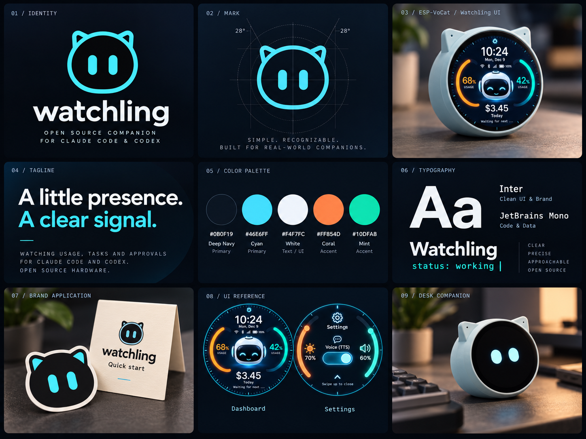
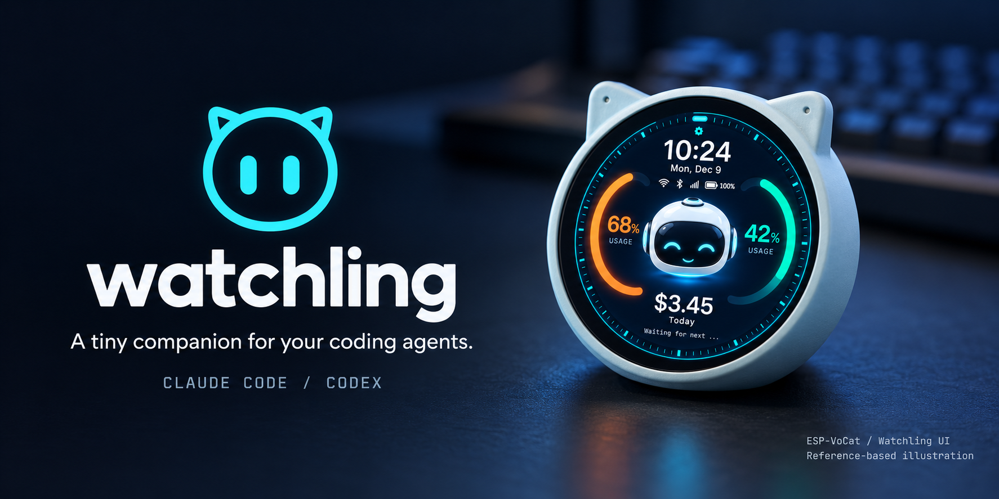

# Watchling — Brand direction

Định hướng nhận diện cho GitHub và tài liệu dự án, tham chiếu ảnh sản phẩm **ESP-VoCat** và mockup giao diện Watchling do chủ dự án cung cấp. Hình sinh là minh họa dựa trên tham chiếu, không phải ảnh chụp thiết bị đang chạy firmware.

## Ý tưởng

**A tiny companion for your coding agents.**

Watchling là một sự hiện diện nhỏ trên bàn làm việc: theo dõi trạng thái Claude Code và Codex, hiển thị mức sử dụng, báo khi cần chú ý và cho phép phản hồi yêu cầu cấp quyền trên thiết bị.

Nhận diện kết hợp độ rõ ràng của công cụ dành cho developer với sự thân thiện của một nhân vật có biểu cảm. Biểu tượng chính là đường viền gần tròn với hai tai mèo nhỏ và hai mắt dạng viên thuốc, lấy từ dáng vỏ ESP-VoCat. Các cung tròn liên hệ với màn hình và vòng hiển thị mức sử dụng hiện có.

## Bảng nhận diện

Hình tổng quan được tạo bằng công cụ image generation theo skill `brandkit`. Logo trên board là hướng concept dạng raster; khi cần favicon hoặc in ấn, cần dựng lại và chốt một bản vector chuẩn từ hướng này.

## Màu sắc

Các mã dưới đây lấy từ giao diện firmware hiện có. Đây là giá trị chuẩn để triển khai; màu trong ảnh concept có thể có sai lệch.

| Token | HEX | Vai trò |
| --- | --- | --- |
| Background | `#0B0F19` | Nền chính |
| Surface / track | `#182638` | Khung, đường chia, đường nền của cung |
| Watchling cyan | `#46E6FF` | Mắt, biểu tượng, điểm nhấn nhận diện |
| Text primary | `#F4F7FC` | Tiêu đề và nội dung chính |
| Text secondary | `#94A3B8` | Chú thích và metadata |
| Claude channel | `#FF854D` | Cung và thông tin Claude |
| Codex channel | `#10DFA8` | Cung và thông tin Codex |
| Attention | `#FBBF24` | Biểu cảm chờ chú ý |
| Error | `#F87171` | Biểu cảm lỗi |

Dùng navy và trắng cho phần lớn diện tích, cyan cho nhận diện; cam và mint xuất hiện khi diễn đạt hai kênh agent. Trạng thái luôn có nhãn hoặc hình dạng đi kèm màu.

## Typography và bố cục

- Tiêu đề: đề xuất **Inter**, weight 500–600; fallback sans-serif hệ thống.
- Nội dung: sans-serif hệ thống để dễ đọc trong tài liệu dài.
- Code, trạng thái và thông số: đề xuất **JetBrains Mono**, weight 400–500; fallback monospace.
- README dùng typography mặc định của GitHub; font đề xuất dành cho hình bìa, trang docs tùy chỉnh và ấn phẩm.
- Hình bìa: một tiêu đề, một câu mô tả, một điểm nhìn chính. Giữ khoảng trống rộng.
- Board nhận diện: lưới 3 × 3, gutter đồng đều, xen kẽ panel yên tĩnh và panel có hình ảnh.

Tên font là đề xuất triển khai, không phải cam kết ảnh sinh đã dùng chính xác font đó. Bộ này chưa kèm file font.

## Hình ảnh và nhân vật

Phần cứng là **ESP-VoCat**: vỏ gần tròn, hai tai mèo nhỏ ở phía trên, kính màn hình tròn màu đen và phần đáy bo tròn. Ảnh tham chiếu có ba màu xanh nhạt, kem và coral; hình chính dùng xanh nhạt. Giữ đúng hình dáng vỏ và tỷ lệ theo ảnh sản phẩm. Dáng đặt trực tiếp trên bàn lấy từ thiết bị bên trái/phải trong ảnh tham chiếu.

Đầu robot trắng trong dashboard là **nội dung trên màn hình**, không phải hình dáng vỏ thiết bị. Dashboard có cung cam bên trái, mint bên phải, robot ở giữa, đồng hồ phía trên và chi phí bên dưới. Settings dùng hai cung brightness/volume và nút Voice (TTS) ở giữa. Mockup kéo Settings chỉ tham chiếu cử chỉ; các chỉ số kWh/CO₂ trong mockup đó không phải tính năng Watchling.

Nhân vật thân thiện, biểu cảm vừa đủ. Ảnh bàn làm việc cần ánh sáng tiết chế, ít đồ vật và thiết bị là điểm nhìn chính.

Phân biệt rõ **concept render**, **simulator capture** và **device photo** trong caption. Khi viết hướng dẫn thao tác, dùng screenshot thật hoặc ảnh thiết bị thật để người đọc đối chiếu.

## Giọng văn

Mô tả cụ thể hành động và trạng thái. Tiêu đề ngắn, lệnh có thể sao chép, mỗi bước có kết quả mong đợi. Hướng dẫn cài đặt cần nói rõ yêu cầu macOS, Node 22, ESP-IDF và board được hỗ trợ theo mã nguồn thực tế.

Copy đề xuất:

- Mô tả repository: **A tiny desk robot that watches your AI coding agents.**
- Câu mô tả trên bìa: **A tiny companion for your coding agents.**
- Câu nhận diện: **A little presence. A clear signal.**

## Áp dụng cho GitHub

Hình bìa ngang được nhúng vào đầu README bằng ``. Phần cứng trong hình minh họa dựa trên ảnh ESP-VoCat; UI dựa trên mockup thiết kế.

| Hạng mục | Thiết kế đề xuất |
| --- | --- |
| README hero | Tên Watchling, câu mô tả, robot hoặc biểu tượng; bản ngang |
| Social preview | 1280 × 640, chữ lớn, khoảng an toàn 80 px quanh nội dung chính |
| Avatar | Đường viền tròn có tai mèo và hai mắt; kiểm tra khả năng nhận diện ở 32 px khi dựng vector |
| Hướng dẫn cài đặt | Bước có số, code block, ảnh thật sau mỗi mốc quan trọng |
| Kiến trúc | Sơ đồ agent → PC bridge → USB/BLE → thiết bị, dùng màu hai kênh nhất quán |

Cấu trúc tài liệu nên phát triển tiếp: Overview → Hardware → Quick start → Agent setup → Daily use → Troubleshooting → Protocol → Contributing. Đây là đề xuất cấu trúc, chưa phải bộ hướng dẫn đã hoàn tất.

## Nguồn thiết kế

- [Prompt tạo board](brand-overview-prompt.txt)
- [Prompt tạo hình bìa](readme-banner-prompt.txt)
- [Ảnh ESP-VoCat do chủ dự án cung cấp](references/esp-vocat.avif)
- [Dashboard mockup](../../plans/261018-1240-settings-screen/mockups/flow-1-handle.png)
- [Settings pull mockup — tham chiếu cử chỉ](../../plans/261018-1240-settings-screen/mockups/flow-2-pulling.png)
- [Settings mockup](../../plans/261018-1240-settings-screen/mockups/settings-a-arcs.png)
- Giao diện màu: `echoear-firmware/main/agent_dashboard.c`
- Biểu cảm: `echoear-firmware/main/robot_face.c`
- Hình đầu robot hiện có: `echoear-firmware/main/assets/robot_head.png`

Phương thức tạo: built-in image generation, không dùng CLI/API fallback. Bản thiết kế không đổi firmware hoặc hành vi bridge.
