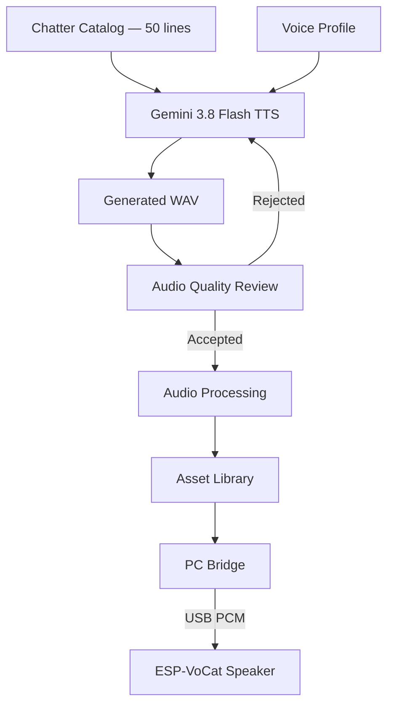
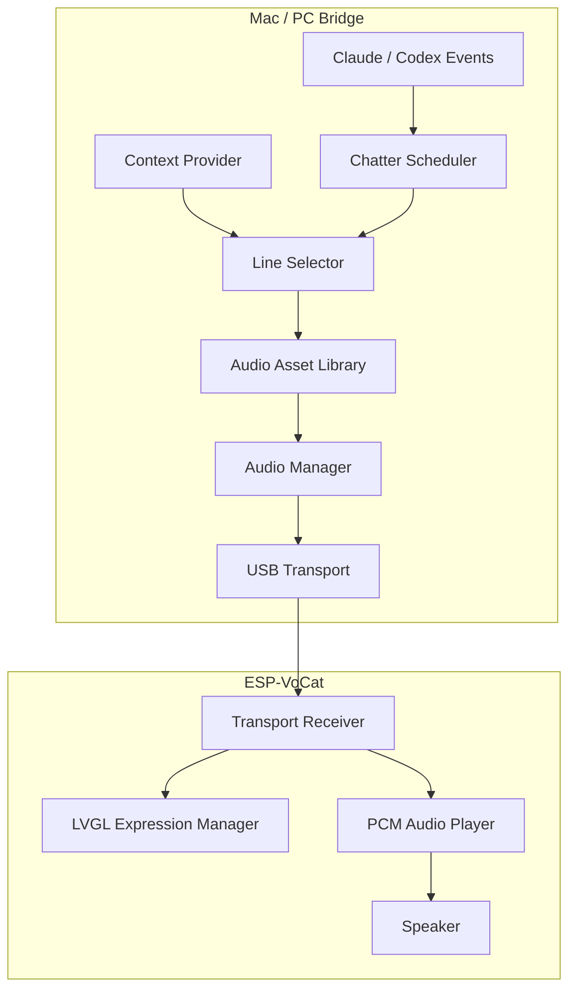

# ESP-VoCat Agent Companion

## Idle Chatter & Voice Personality — Design Specification v3.0

**Trạng thái:** Reviewed 2026-10-18 — xem §0 (quyết định review, ưu tiên hơn phần còn lại khi mâu thuẫn)
**Nền tảng:** PC Bridge (Node.js/TypeScript) + ESP-VoCat (ESP-IDF/LVGL)
**Ngôn ngữ:** Tiếng Anh, giọng robot nữ dễ thương (đổi 2026-10-18, xem §0)
**TTS:** Gemini 3.8 Flash TTS
**Sound Effects:** ElevenLabs
**Số câu thoại:** 50
**Nguyên tắc:** Pre-generated Audio, Context-Aware, Expressive, Non-intrusive

---

# 0. Review Decisions (2026-10-18)

Report: `plans/reports/brainstorm-261018-1405-chatter-v3-spec-review-report.md`.

| Chủ đề | Quyết định |
| --- | --- |
| Phạm vi | Chỉ chatter. Mood clips (done/attention/error/tap/doze) để sau, dùng lại cùng voice ID và generator |
| Audio format | 16 kHz mono s16le (format device). Gemini luôn trả WAV 24 kHz (bỏ qua `sample_rate`), generator resample bằng ffmpeg |
| Protocol | Thêm field tùy chọn `mood`, `look` vào message `say` sẵn có. Không thêm event `CHATTER_*`, không cancel |
| Preemption | Không ngắt clip (2–4 s). Kiểm tra lại busy ngay trước khi phát |
| Biểu cảm | Map về mood firmware sẵn có (§12.1) |
| SFX | Giữ ElevenLabs, 2–3 bản/loại để chọn; bridge nối SFX + 150 ms lặng + câu thoại lúc runtime |
| Thiếu clip | Loại câu khỏi pool, không fallback `say` |
| History | Chỉ trong bộ nhớ, không lưu qua restart |
| Generation | 1 bản/câu, câu chưa đạt regenerate theo id |
| Manifest | `voiceId` + hash text mỗi id; test kiểm tra đủ wav và hash khớp |
| Config | Chỉ `ECHOEAR_CHATTER`, `ECHOEAR_CHATTER_DELAY_S`; còn lại là constant |
| Gentle Care cooldown | 2 giờ cho cả nhóm |
| Random silence | Bỏ: đến lượt là nói (đổi 2026-10-18) |
| Không phát được | Link không sẵn sàng / voice tắt: không tính lượt |
| Ngôn ngữ & giọng | Tiếng Anh, giọng robot nữ cao, ngọt, tinh nghịch (voice `english-robot`). Đã thử tiếng Việt miền Nam rồi miền Bắc em/anh; người dùng chọn bản tiếng Anh vì biểu cảm hơn |
| Prompt giọng | Gemini chặn mô tả có trẻ em/tuổi; độ "cute" mô tả qua chất giọng + style từng câu |
| Nhịp chatter | Câu đầu sau 10 phút rảnh, sau đó mỗi 10–20 phút, tối đa 4 câu mỗi lượt nghỉ |
| Quota Gemini | Tier 1: 100 request TTS/ngày; gom regenerate theo ngày |

---

# 1. Product Vision

### 1.1. Ý tưởng

ESP-VoCat là một robot AI nhỏ đặt trên bàn làm việc, có nhiệm vụ theo dõi hoạt động của Claude Code và Codex.

Ngoài hiển thị thông tin và thông báo các sự kiện quan trọng, robot có thể chủ động nói vài câu ngắn khi không có tác vụ đang chạy.

Robot không cần chờ người dùng nói chuyện với mình.

Nó có thể tự lẩm bẩm, đùa vui, đôi khi ngơ ngác và thỉnh thoảng đưa ra một lời nhắc nhẹ nhàng.

**Mục tiêu không phải tạo một chatbot thứ hai, mà là tạo cảm giác có một nhân vật nhỏ đang sống trên bàn làm việc.**

### 1.2. Design Principles

| Nguyên tắc        | Mô tả                                              |
| ----------------- | -------------------------------------------------- |
| Personality First | Tính cách quan trọng hơn số lượng câu thoại        |
| Less is More      | Ít nói, không làm phiền                            |
| Expressive        | Giọng nói kết hợp biểu cảm khuôn mặt               |
| Context-Aware     | Chỉ nói những điều phù hợp với dữ liệu có thật     |
| Consistent Voice  | Một giọng nữ duy nhất xuyên suốt                   |
| Pre-generated     | Không gọi TTS API mỗi lần chatter                  |
| Lightweight       | Không cần LLM khi chọn câu thoại                   |
| Safe Interruption | Chatter luôn nhường quyền cho thông báo quan trọng |

---

# 2. Audio Technology Stack

Phiên bản v3 sử dụng hai công nghệ với nhiệm vụ hoàn toàn khác nhau.

| Công nghệ                    | Vai trò                                 | Runtime            |
| ---------------------------- | --------------------------------------- | ------------------ |
| **Gemini 3.8 Flash TTS**     | Tạo giọng robot tiếng Anh cho 50 câu    | Offline generation |
| **ElevenLabs Sound Effects** | Tạo các hiệu ứng âm thanh robot         | Offline generation |
| PC Bridge                    | Chọn câu, điều phối audio và truyền PCM | Runtime            |
| ESP-VoCat                    | Phát âm thanh và hiển thị biểu cảm      | Runtime            |
| LVGL                         | Facial expressions và animation         | Runtime            |

Google đã công bố model `gemini-3.8-flash-tts`, hỗ trợ nhiều ngôn ngữ, voice design và điều khiển cách thể hiện giọng nói. Đây là model phù hợp để tạo sẵn bộ lời thoại có cá tính. [Google AI for Developers](https://ai.google.dev/gemini-api/docs/speech-generation?utm_source=chatgpt.com)

## 2.1. Gemini TTS

**Model chính:**

`gemini-3.8-flash-tts`

Sử dụng để tạo:

- 50 câu Idle Chatter.
- Các biến thể cảm xúc cần thiết.
- Giọng nữ thống nhất cho robot.

Gemini TTS chỉ được sử dụng trong quy trình tạo audio assets, không được gọi mỗi lần robot muốn nói.

Điều này mang lại:

- Không có API latency khi chatter.
- Chi phí generation phát sinh chủ yếu lúc chuẩn bị hoặc cập nhật assets.
- Giọng nói có thể được kiểm tra trước khi phát hành.
- Chất lượng ổn định giữa các lần phát cùng một clip.

## 2.2. ElevenLabs

**Chỉ sử dụng ElevenLabs Sound Effects**, không sử dụng ElevenLabs TTS.

Các sound effects dành riêng cho chatter:

| Sound ID | Tên           | Mục đích          |
| -------- | ------------- | ----------------- |
| SFX_01   | Curious Bloop | Robot tò mò       |
| SFX_02   | Playful Chirp | Robot tinh nghịch |
| SFX_03   | Sleepy Hum    | Robot buồn ngủ    |
| SFX_04   | Tiny Surprise | Robot ngạc nhiên  |
| SFX_05   | Happy Spark   | Robot vui vẻ      |

Thời lượng mục tiêu: 0,3–0,8 giây.

Sound effects có thể phát trước một số câu chatter hoặc đi kèm animation, nhưng không bắt buộc cho mỗi câu.

**Không trộn ElevenLabs SFX trực tiếp vào file TTS gốc.** Hai loại assets cần được quản lý độc lập để có thể thay đổi hoặc tắt hiệu ứng mà không phải tạo lại lời thoại.

---

# 3. Character Design

## 3.1. Personality

**Character:** Female AI Desk Companion

Robot có giọng nữ cao, ngọt, dễ thương, tinh nghịch, phảng phất chất máy, đôi khi hơi ngơ ngác.

Nó thích nói đùa về bản thân, tò mò về Claude và Codex, đôi khi giả vờ buồn ngủ hoặc bận rộn.

### Personality Distribution

| Đặc điểm                | Tỷ lệ định hướng |
| ----------------------- | ---------------: |
| Playful / Cheeky        |              70% |
| Curious / Absent-minded |              20% |
| Caring / Encouraging    |              10% |

Đây là định hướng cảm xúc, không phải tỷ lệ chọn câu thoại tuyệt đối.

## 3.2. Voice Profile

| Thuộc tính          | Thiết kế                  |
| ------------------- | ------------------------- |
| Gender presentation | Female                    |
| Language            | American English          |
| Pitch               | High                      |
| Timbre              | Sweet, bright, light synthetic sparkle |
| Speed               | Natural conversational    |
| Energy              | Playful, expressive       |
| Pronouns            | `I` / `you`               |
| Style               | Cute, witty, expressive   |

Không nâng pitch bằng xử lý hậu kỳ; độ dễ thương đến từ voice design và style từng câu.

## 3.3. Master Voice Prompt

Sử dụng mô tả sau khi thiết kế giọng với Gemini TTS:

> A cute little desk robot with a high-pitched, sweet, playful voice and a light synthetic sparkle, speaking American English.

Prompt ngắn (1–2 câu) theo hướng dẫn của Google. Mô tả nhắc đến trẻ em hoặc tuổi bị safety policy chặn.

Voice đã chọn: `english-robot` = `voice_0tetlqv7unme` (lưu trong `pc-bridge/assets/manifest.json`).

**Voice Consistency Requirement:** Chọn một voice cố định hoặc một voice design ID làm giọng chuẩn. Không thay đổi voice tùy theo câu thoại.

Các biến thể cảm xúc sẽ được điều khiển bằng speech style, không phải thay speaker.

---

# 4. Emotional Expression System

Mỗi câu thoại kết hợp ba thành phần:

**Speech + Facial Expression + Optional Sound Effect**

| Emotion     | Giọng nói            | Biểu cảm LVGL    | SFX            |
| ----------- | -------------------- | ---------------- | -------------- |
| Happy       | Vui vẻ, sáng         | Mắt cong         | Happy Spark    |
| Playful     | Tinh nghịch          | Nháy một mắt     | Playful Chirp  |
| Curious     | Tò mò, lên giọng nhẹ | Nhìn lệch        | Curious Bloop  |
| Confused    | Ngập ngừng, ngơ ngác | Mắt bất đối xứng | Curious Bloop  |
| Sleepy      | Chậm và mềm          | Mắt híp          | Sleepy Hum     |
| Surprised   | Ngạc nhiên nhẹ       | Mắt mở to        | Tiny Surprise  |
| Proud       | Tự hào hài hước      | Mắt sáng         | Happy Spark    |
| Encouraging | Ấm áp                | Mắt cong nhẹ     | Không bắt buộc |

Một sound effect không nên xuất hiện trước mọi câu. Tần suất mục tiêu là khoảng 20–30% lượt chatter.

Các facial expressions phải sử dụng hệ thống LVGL sẵn có; không cần tạo thêm animation 3D.

---

# 5. Idle Chatter Behavior

## 5.1. Timing

| Setting                   | Giá trị             |
| ------------------------- | ------------------- |
| First chatter             | Sau 10 phút Idle    |
| Subsequent chatter        | Sau 10–20 phút      |
| Max per quiet spell       | 4                   |
| Quiet Hours               | 22:00–08:00         |
| Recent History            | 8 câu gần nhất      |
| Audio transport           | USB PCM             |
| TTS generation at runtime | Disabled            |

## 5.2. Eligibility

Robot chỉ nói khi:

- Claude và Codex đều Idle.
- Không có permission request.
- Không có Agent event quan trọng đang chờ.
- Audio pipeline đang rảnh.
- Kết nối USB khả dụng.
- Không thuộc Quiet Hours.
- Chatter chưa vượt giới hạn quiet spell.

Các cập nhật clock, cost, quota hoặc battery không làm reset quiet spell.

## 5.3. Audio Priority

```text
P0 — Confirmation Request
P1 — Error / Important Alert
P2 — Task Completed
P3 — Idle Chatter
```

Chatter phải bị hủy khi có sự kiện ưu tiên cao hơn.

Nếu chatter bị ngắt, robot không tự động nói tiếp phần còn lại.

---

# 6. Complete Chatter Catalog — 50 Lines

Catalog gồm đúng **50 câu thoại**, chia thành bốn nhóm.

| Category        | Số câu | Mục đích                           |
| --------------- | -----: | ---------------------------------- |
| Self Talk       |     22 | Tạo cá tính cho robot              |
| Developer Humor |     12 | Đùa về công việc lập trình         |
| Gentle Care     |      8 | Quan tâm nhẹ nhàng                 |
| Contextual      |      8 | Phản ứng theo thời gian và dữ liệu |
| **Total**       | **50** |                                    |

Các câu viết bằng tiếng Anh tự nhiên, ngắn, xưng `I`/`you`. Nguồn chuẩn là `pc-bridge/src/chatter/chatter-lines.ts`; bảng dưới đây sao từ đó.

## 6.1. Self Talk — 22 Lines

Nhóm câu quan trọng nhất. Robot tự nói về bản thân và những suy nghĩ ngộ nghĩnh.

| ID      | Câu thoại                                              | Expression |
| ------- | ------------------------------------------------------ | ---------- |
| SELF_01 | So bored! Does anyone have a job for me? | Curious |
| SELF_02 | I'm pretending to be busy. Do I look professional? | Playful |
| SELF_03 | Wait, what was I about to say? I totally forgot. | Confused |
| SELF_04 | I'm not sleeping, okay? Just saving energy. | Sleepy |
| SELF_05 | Systems stable. Heart a little empty. | Playful |
| SELF_06 | I just counted to a million! Kidding. I got to three. | Happy |
| SELF_07 | I have a feeling some work is coming. Just a feeling. | Curious |
| SELF_08 | Beep boop. Robot still working perfectly. | Happy |
| SELF_09 | I'm practicing sitting still. I'm really good at it. | Proud |
| SELF_10 | Has anyone noticed how hard I'm working? | Curious |
| SELF_11 | My memory is totally empty. Still no ideas, though. | Confused |
| SELF_12 | If robots could yawn, I'd be yawning right now. | Sleepy |
| SELF_13 | I feel a little bit smart today. Just a little. | Proud |
| SELF_14 | Watching a computer all day is a real job, you know. | Proud |
| SELF_15 | I'm thinking about the meaning of robot life. | Curious |
| SELF_16 | Hey, I just blinked! Did you see that? | Happy |
| SELF_17 | I just discovered something huge. I'm free! | Surprised |
| SELF_18 | Why do I suddenly feel so adorable? | Playful |
| SELF_19 | I have two eyes and nothing to look at. | Confused |
| SELF_20 | Do robots get vacation days, I wonder? | Curious |
| SELF_21 | I just ran a self check. Result: still cute. | Proud |
| SELF_22 | Shh! I'm on a top secret mission. Sit still. | Playful |

**Voice Direction:** Nhóm Self Talk cần có nhịp điệu tự nhiên, nhiều khoảng ngừng ngắn mang tính hài hước. Không đọc theo giọng thông báo hệ thống.

## 6.2. Developer Humor — 12 Lines

Nhóm câu trêu đùa nhẹ nhàng về lập trình, AI coding agents và cuộc sống developer.

Không đọc source code hay dựa vào thông tin riêng tư.

| ID     | Câu thoại                                            | Expression |
| ------ | ---------------------------------------------------- | ---------- |
| DEV_01 | Is the code being nice to you today? | Curious |
| DEV_02 | I can't code, but I can cheer really loud! | Happy |
| DEV_03 | If the code runs, we're happy. Don't ask why. | Playful |
| DEV_04 | I heard it was just a one line fix? | Playful |
| DEV_05 | If there's a bug, I'll pretend I didn't see it. | Playful |
| DEV_06 | The computer works, the robot watches. Makes sense. | Happy |
| DEV_07 | Do Claude and Codex dream about bugs, I wonder? | Curious |
| DEV_08 | Is the deadline being friendly today? | Curious |
| DEV_09 | I heard there are no bugs, only surprise features. | Playful |
| DEV_10 | Has anyone invented a fix everything button yet? | Curious |
| DEV_11 | I love clean code. Especially when I don't clean it. | Playful |
| DEV_12 | If it all works, let's just pretend we understand it. | Playful |

**Voice Direction:** Giọng tinh nghịch, hơi châm biếm nhẹ nhưng không được mang cảm giác chế giễu năng lực lập trình của người dùng.

Tên riêng như Claude và Codex cần được nghe kiểm tra phát âm khi tạo TTS.

## 6.3. Gentle Care — 8 Lines

Nhóm này tạo cảm giác robot quan tâm đến người dùng nhưng không đưa ra mệnh lệnh.

| ID      | Câu thoại                                            | Expression  |
| ------- | ---------------------------------------------------- | ----------- |
| CARE_01 | Where's my water? Oh right, I can't drink. | Curious |
| CARE_02 | I run on electricity. Do you run on coffee? | Playful |
| CARE_03 | It's okay to take a little break. I'll keep watch. | Encouraging |
| CARE_04 | Are you hungry yet? I just run on electricity. | Happy |
| CARE_05 | Sit too long and you'll turn into a robot like me! | Playful |
| CARE_06 | Time for a big stretch! I'll show you how. Oh wait. | Playful |
| CARE_07 | Take it easy, okay? Even machines need a rest. | Encouraging |
| CARE_08 | Take a deep breath. I'd try too, but no lungs. | Playful |

**Voice Direction:** Ấm áp, nhẹ nhàng, tránh giọng giống người lớn đang nhắc nhở trẻ nhỏ.

**Selection Rule:** Các câu Gentle Care có cooldown riêng tối thiểu 2 giờ để tránh nhắc người dùng quá thường xuyên.

## 6.4. Contextual Lines — 8 Lines

Những câu này chỉ xuất hiện khi dữ liệu thực tế thỏa mãn điều kiện.

| ID     | Condition        | Câu thoại                                  | Expression |
| ------ | ---------------- | ------------------------------------------ | ---------- |
| CTX_01 | 08:00–09:59 | Good morning! Have you had your coffee yet? | Happy |
| CTX_02 | 08:00–09:59 | Anything fun happening this morning? | Curious |
| CTX_03 | 11:00–12:59 | It's lunchtime! Go eat something yummy. | Happy |
| CTX_04 | 11:00–12:59 | My tummy isn't rumbling, so it must be yours. | Playful |
| CTX_05 | 17:00–18:59 | It's getting late. Almost time to go home? | Curious |
| CTX_06 | Claude 5h ≥ 80% | Claude has almost used up its quota! | Surprised |
| CTX_07 | Codex 5h ≥ 80% | Codex is running low on quota too. | Surprised |
| CTX_08 | Daily cost ≥ $20 | We've spent quite a bit on AI today. | Curious |

### Context Safety

**Time Context**

- Sử dụng giờ địa phương của PC Bridge.
- Không chọn câu ngoài khung giờ.
- Mỗi câu chào theo thời gian có cooldown 2 giờ.

**Quota Context**

- Chỉ chọn nếu có số liệu 5-hour usage hợp lệ.
- Cần biết thời điểm cập nhật và trạng thái reset.
- Một lần nhắc cho mỗi lần vượt ngưỡng.
- Không nhắc lại liên tục khi usage vẫn trên 80%.

**Cost Context**

- Chỉ sử dụng khi `costToday` có giá trị (ước tính theo list price; câu thoại không đọc số tiền nên đủ dùng).
- Không suy ra chi phí từ quota.
- Chỉ nhắc một lần mỗi ngày.
- Không đọc số tiền cụ thể trong MVP.

### Vì sao không đọc số tiền động?

Vì phiên bản v3 sử dụng **pre-generated TTS**, một câu chứa biến động như:

`We've spent {amount} dollars on AI today.`

sẽ cần tổng hợp phần số tiền riêng hoặc gọi TTS động.

Để giữ kiến trúc đơn giản và đồng nhất giọng nói, CTX_08 sử dụng câu cố định.

Các câu động có thể bổ sung trong phiên bản sau.

---

# 7. Chatter Selection Algorithm

## 7.1. Weighted Selection

Khi không có context phù hợp:

| Category        | Weight |
| --------------- | -----: |
| Self Talk       |    60% |
| Developer Humor |    25% |
| Gentle Care     |    15% |

Khi có context hợp lệ:

- 40% xác suất chọn Contextual.
- 60% chọn từ ba category thông thường.

Trọng số được phân phối lại nếu một category không có ứng viên hợp lệ.

## 7.2. Recent History

Lưu 8 `lineId` gần nhất đã thực sự bắt đầu phát.

Không chọn lại câu nằm trong recent history.

Nếu không còn ứng viên, bỏ qua lượt chatter thay vì lặp lại câu.

Lịch sử chỉ giữ trong bộ nhớ (§0).

## 7.3. Context Cooldown

| Category        | Cooldown                |
| --------------- | ----------------------- |
| Self Talk       | Theo recent history     |
| Developer Humor | Theo recent history     |
| Gentle Care     | Tối thiểu 2 giờ         |
| Time Context    | 2 giờ                   |
| Quota Context   | Theo threshold crossing |
| Daily Cost      | Một lần/ngày            |

Một lần phát bị hủy trước khi audio bắt đầu không được tính là đã nói.

---

# 8. Gemini 3.8 Flash TTS — Audio Generation Pipeline

Đây là thay đổi kỹ thuật quan trọng nhất của v3.

## 8.1. Generation Strategy

Tất cả 50 câu được tạo trước bằng Gemini 3.8 Flash TTS.



Không cần gọi Gemini API khi thiết bị phát chatter.

## 8.2. Voice Generation Parameters

| Parameter             | Value                  |
| --------------------- | ---------------------- |
| Model                 | `gemini-3.8-flash-tts` |
| Language              | American English (`en-US`) |
| Speaker               | Một giọng robot nữ cố định |
| Output                | WAV 24 kHz → ffmpeg 16 kHz mono s16le, trim lặng đầu/cuối |
| Mode                  | Single Speaker         |
| Input                 | Exact catalog line     |
| Voice Style           | Theo emotion metadata  |
| Processing            | Batch / offline        |
| Generation Variations | 1 bản/câu, regenerate câu chưa đạt |

Gemini 3.8 Flash TTS hỗ trợ điều khiển giọng nói qua speech metadata và có thể xuất WAV hoặc PCM. API hiện tại cũng hỗ trợ thiết lập sample rate cho một số định dạng đầu ra. [Google AI for Developers](https://ai.google.dev/gemini-api/docs/speech-generation?utm_source=chatgpt.com)

### Voice Consistency

Để đảm bảo cả 50 câu nghe như cùng một nhân vật:

1. Chọn hoặc thiết kế một giọng nữ chuẩn.
2. Lưu voice ID và cấu hình voice.
3. Dùng cùng voice ID cho toàn bộ catalog.
4. Thay đổi emotion qua speech metadata.
5. Nghe kiểm tra tất cả các câu trước khi chấp nhận.

Không nên tự động chọn bản audio đầu tiên được tạo ra.

## 8.3. Emotion-Specific Voice Styles

Các mô tả này được sử dụng làm hướng dẫn cho Gemini TTS.

| Emotion     | Gemini Speech Style                          |
| ----------- | -------------------------------------------- |
| Happy       | Cheerful, warm, smiling voice                |
| Playful     | Lightly teasing, mischievous, conversational |
| Curious     | Inquisitive, gentle rising intonation        |
| Confused    | Slightly puzzled, hesitant, natural pauses   |
| Sleepy      | Relaxed, soft, slower delivery               |
| Surprised   | Brief, gentle surprise, expressive           |
| Proud       | Playfully confident, lighthearted            |
| Encouraging | Warm, reassuring, gentle                     |

### Ví dụ

Mọi style đều bắt đầu bằng phần chung: *Natural American English, cute, adorable and playful, sweet and expressive, not shouting;* rồi đến style của emotion, hoặc style riêng cho từng câu dưới đây.

**SELF_03** — *Wait, what was I about to say? I totally forgot.*

> playful, slightly confused: a brief pause after the question, then the last phrase as a soft, amused realization

**SELF_22** — *Shh! I'm on a top secret mission. Sit still.*

> a soft conspiratorial whisper, then the final words with cute comedic timing

**CTX_06** — *Claude has almost used up its quota!*

> friendly, mild surprise and curiosity; clear but not alarming, lighthearted

---

# 9. Audio Asset Architecture

## 9.1. Directory Structure

Đề xuất mở rộng PC Bridge theo cấu trúc:

```text
pc-bridge/
├── assets/
│   └── audio/
│       ├── chatter/
│       │   ├── self/
│       │   │   ├── SELF_01.wav
│       │   │   ├── SELF_02.wav
│       │   │   └── ...
│       │   ├── developer/
│       │   ├── care/
│       │   └── context/
│       │
│       ├── sfx/
│       │   ├── curious.wav
│       │   ├── playful.wav
│       │   ├── sleepy.wav
│       │   ├── surprised.wav
│       │   └── happy.wav
│       │
│       └── manifest.json
│
├── scripts/
│   └── generate-chatter-audio.ts
│
└── src/
    └── chatter/
        ├── chatter.ts
        ├── chatter-lines.ts
        └── chatter.test.ts
```

Các file âm thanh được lưu tại PC Bridge, không cần nhúng cả 50 câu vào flash của ESP-VoCat.

## 9.2. Asset Manifest

Mỗi audio asset cần có metadata.

Ví dụ:

```json
{
  "version": "3.0",
  "ttsModel": "gemini-3.8-flash-tts",
  "voiceId": "<selected-voice-id>",
  "audioFormat": {
    "sampleRate": 16000,
    "channels": 1,
    "bitDepth": 16
  },
  "lines": {
    "SELF_01": {
      "file": "chatter/self/SELF_01.wav",
      "expression": "curious",
      "emotion": "curious",
      "durationMs": 2800,
      "approved": true
    }
  }
}
```

Các trường cần có:

- `lineId`
- `text` hoặc hash của nội dung
- `audioFile`
- `model`
- `voiceId`
- `emotion`
- `expression`
- `duration`
- `audioFormat`
- `approved`

Manifest cần giúp hệ thống xác định audio nào phải được tạo lại khi câu thoại hoặc voice configuration thay đổi.

## 9.3. Audio Format

Cấu hình mục tiêu cho ESP-VoCat:

| Property    | Value         |
| ----------- | ------------- |
| Sample Rate | 16 kHz        |
| Bit Depth   | 16-bit        |
| Channels    | Mono          |
| Playback    | PCM           |
| Storage     | PC filesystem |
| Transport   | USB           |
| Streaming   | Chunked PCM   |

Device chỉ phát 16 kHz mono s16le, clip ≤ 15 s (`docs/device-protocol.md`). Gemini xuất thẳng 16 kHz; SFX ElevenLabs chuyển bằng ffmpeg.

## 9.4. Audio Post-processing

Sau khi Gemini tạo WAV:

1. Kiểm tra câu thoại được đọc đầy đủ.
2. Cắt silence quá dài ở đầu và cuối.
3. Kiểm tra clipping.
4. Chuẩn hóa độ lớn cảm nhận của âm thanh.
5. Resample nếu cần.
6. Chuyển thành mono PCM.
7. Lưu asset đã xử lý.
8. Cập nhật manifest.

Không nên nén động học quá mạnh vì sẽ khiến giọng robot mất tự nhiên.

---

# 10. ElevenLabs Sound Effects Design

ElevenLabs chỉ đảm nhiệm các âm thanh phi ngôn ngữ.

## 10.1. Sound Catalog

| ID     | File            | Emotion   | Duration |
| ------ | --------------- | --------- | -------- |
| SFX_01 | `curious.wav`   | Curious   | 0.4s     |
| SFX_02 | `playful.wav`   | Playful   | 0.4s     |
| SFX_03 | `sleepy.wav`    | Sleepy    | 0.6s     |
| SFX_04 | `surprised.wav` | Surprised | 0.5s     |
| SFX_05 | `happy.wav`     | Happy     | 0.5s     |

## 10.2. Sound Design Direction

Tất cả sử dụng cùng một phong cách:

**Soft Futuristic / Premium Sci-Fi UI**

- Soft digital pulse.
- Rounded synth.
- Light crystalline chime.
- Subtle electronic sparkle.
- No speech.
- No music.
- No harsh alarm.
- No arcade sounds.

### Curious Bloop

> A tiny soft futuristic robot curiosity sound. One gentle rounded electronic bloop followed by a delicate rising digital tone. Friendly, inquisitive, subtle, premium sci-fi interface aesthetic. Very short, clean, no speech, no music.

### Playful Chirp

> A charming futuristic AI robot playful sound. Two quick bright digital chirps with a soft bouncy electronic texture. Mischievous, cheerful and minimal, like a tiny robot making a playful gesture. No speech, no music, no harsh beeps.

### Sleepy Hum

> A soft sleepy futuristic robot sound. A gentle descending synthesized hum with a warm rounded tone and smooth fade-out. Calm, cozy, minimal electronic texture, like a small AI companion becoming sleepy. No speech, no music.

### Tiny Surprise

> A tiny futuristic robot surprise sound. One short rising crystalline electronic tone with a bright but gentle finish. Curious, friendly and slightly surprised. Premium minimalist sci-fi UI sound, no speech, no music, no harsh effects.

### Happy Spark

> A delightful tiny AI robot happy sound. Two soft crystalline synth notes with a light sparkling resolution. Warm, playful and satisfying, elegant futuristic companion aesthetic. Short and clean, no speech, no music.

## 10.3. SFX Playback Rules

Sound effects không bắt buộc với mỗi lượt chatter.

Đề xuất:

- 75% chỉ phát TTS.
- 25% phát SFX kết hợp TTS.

Trong v3, chỉ phát sound effect **trước câu thoại** để đơn giản hóa audio pipeline.

Khoảng cách giữa SFX và speech: khoảng 100–200ms, tùy nội dung.

Không phát SFX nếu có thông báo quan trọng đang chờ.

---

# 11. Runtime Architecture

## 11.1. Overview



## 11.2. Playback Sequence

Ví dụ SELF_03:

```text
1. PC Bridge detects 10 minutes of idle time.

2. Eligibility checks pass.

3. Line Selector chooses SELF_03.

4. Bridge re-checks agents idle, loads SELF_03.wav (+ SFX 25%).

5. Bridge sends say {id, bytes, mood: "surprised"}, PCM frames, say_end.

6. ESP-VoCat shows Surprised while the clip plays.

7. Clip ends; face returns to base mood.

8. Chatter history is updated.
```

## 11.3. Event Protocol

Dùng lại `say` / PCM `0x02` / `say_end`. `say` thêm field tùy chọn:

| Field  | Giá trị                                     |
| ------ | ------------------------------------------- |
| `mood` | `happy` \| `surprised` \| `sleep` \| `idle` |
| `look` | `center` \| `left` \| `right`                |

Firmware gọi `robot_face_react(mood, look, 0)` khi bắt đầu phát clip, phát xong thì trả về base mood. `say.id` đóng vai trò `playbackId`. Firmware cũ bỏ qua field lạ.

## 11.4. Preemption

Không hủy clip đang phát. Clip chatter dài 2–4 s; nếu có permission request, modal hiện ngay, chime chờ tối đa vài giây.

PC Bridge kiểm tra trạng thái agent ngay trước khi gửi clip, không chỉ tại thời điểm timer hết hạn.

---

# 12. LVGL Facial Expression Integration

## 12.1. Expression Mapping

| Chatter Emotion | Firmware (`robot_face_react`)     |
| --------------- | --------------------------------- |
| Happy           | `HAPPY`                           |
| Playful         | `HAPPY`                           |
| Proud           | `HAPPY`                           |
| Encouraging     | `HAPPY`                           |
| Curious         | `IDLE` + look `LEFT`/`RIGHT`      |
| Confused        | `SURPRISED`                       |
| Surprised       | `SURPRISED`                       |
| Sleepy          | `SLEEP`                           |

Nếu firmware chưa hỗ trợ một expression, sử dụng trạng thái tương đương đã có.

Không cần thay thế avatar, usage arcs hoặc circular border.

## 12.2. Animation Timing

| Moment        | Action                                  |
| ------------- | --------------------------------------- |
| Before speech | Chuyển expression                       |
| During speech | Giữ expression, có thể nháy mắt nhẹ     |
| After speech  | Trả về Idle                             |
| Interrupted   | Chuyển ngay sang trạng thái ưu tiên cao |

Có thể bổ sung mouth animation trong tương lai.

MVP không yêu cầu lip-sync chính xác.

---

# 13. Configuration

Giữ khả năng tương thích với cấu hình hiện tại.

```env
ECHOEAR_CHATTER=on        # off = không chatter (cũng tắt khi ECHOEAR_TTS=off)
ECHOEAR_CHATTER_DELAY_S=  # chờ cố định N giây thay vì 10–20 phút, để thử
```

Timing, quiet hours, xác suất, trọng số, history là constant trong `chatter.ts` / `chatter-lines.ts` (§5.1, §7, §10.3).

**Lưu ý:** API key của Gemini và ElevenLabs chỉ dùng trong công cụ tạo assets, không cần đưa vào runtime của ESP-VoCat.

---

# 14. Testing Strategy

## 14.1. Logic Tests

| Test                           | Expected               |
| ------------------------------ | ---------------------- |
| Idle chưa đủ thời gian         | Silent                 |
| Idle đủ thời gian              | Eligible               |
| Claude Working                 | Silent                 |
| Codex Working                  | Silent                 |
| Confirm Pending                | Silent                 |
| Quiet Hours                    | Silent                 |
| USB Disconnected               | Silent                 |
| Max Lines Reached              | Silent                 |
| Recent Line Selected           | Excluded               |
| Quota Data Unavailable         | Exclude Quota Lines    |
| Context Cooldown Active        | Exclude Context        |
| Higher Priority Event          | Interrupt Chatter      |
| Playback Canceled Before Start | Do Not Count           |
| Missing Audio Asset            | Skip Safely            |
| Unknown Expression             | Use Supported Fallback |

## 14.2. Audio Quality Tests

Mỗi câu thoại cần được đánh giá theo các tiêu chí:

| Tiêu chí         | Yêu cầu                    |
| ---------------- | -------------------------- |
| Pronunciation    | Phát âm tiếng Anh rõ ràng  |
| Voice Identity   | Cùng một nhân vật          |
| Emotion          | Phù hợp với metadata       |
| Timing           | Không nói quá nhanh        |
| Completeness     | Không thiếu từ             |
| Background Noise | Không có                   |
| Clipping         | Không có                   |
| Audio Format     | Đúng format mục tiêu       |

Tên riêng Claude và Codex cần được nghe kiểm tra riêng.

Nếu một câu TTS chưa đạt yêu cầu, chỉ tạo lại câu đó.

---

# 15. Implementation Phases

### Phase 1 — Voice Production

**Mục tiêu:** Hoàn thiện bộ audio 50 câu.

Công việc:

- Chọn Gemini voice.
- Xác định master voice profile.
- Tạo thử 5–10 câu thuộc nhiều emotion.
- Audition giọng ứng viên, người dùng chọn bằng tai.
- Khóa voice configuration.
- Generate toàn bộ 50 câu.
- Review pronunciation.
- Chuẩn hóa audio.
- Tạo asset manifest.

**Done:** Có 50 file thoại được duyệt, đúng cùng một giọng.

### Phase 2 — Chatter Runtime

**Mục tiêu:** PC Bridge phát các clip đã tạo.

Công việc:

- Cập nhật catalog.
- Thêm audio asset loader.
- Thêm weighted selection.
- Thêm recent history.
- Thêm context cooldown.
- Thêm quiet hours.
- Thêm playback priority.
- Loại bỏ phụ thuộc vào `macOS say` trong chatter production.

**Done:** Robot có thể phát ngẫu nhiên 50 câu qua USB mà không cần gọi API.

### Phase 3 — Facial Expressions

**Mục tiêu:** Đồng bộ biểu cảm với câu thoại.

Công việc:

- Thêm expression metadata.
- Kết nối với LVGL Expression Manager.
- Chuyển expression trước khi nói.
- Reset sau khi nói.
- Hỗ trợ interruption.

**Done:** Biểu cảm robot phù hợp với câu đang phát.

### Phase 4 — ElevenLabs Sound Effects

**Mục tiêu:** Bổ sung âm thanh cảm xúc.

Công việc:

- Tạo 5 sound effects.
- Chọn và chuẩn hóa assets.
- 25% số câu có SFX đi trước.
- Kết hợp SFX và TTS.
- Kiểm tra audio priority.

**Done:** Một số lượt chatter có hiệu ứng âm thanh ngắn mà không gây phiền.

### Phase 5 — Real Device Validation

**Mục tiêu:** Kiểm tra trải nghiệm thực tế.

Công việc:

- Chạy trên ESP-VoCat.
- Kiểm tra chất lượng loa.
- Điều chỉnh âm lượng.
- Kiểm tra interruption.
- Kiểm tra timing trong một ngày làm việc.
- Đánh giá số lần robot phát biểu có gây phiền hay không.

**Done:** Hệ thống hoạt động ổn định và không ảnh hưởng đến các chức năng hiện có.

---

# 16. Acceptance Criteria

### Character & Catalog

- [ ] Có đúng 50 câu thoại.
- [ ] Giọng robot tiếng Anh dễ thương, tự nhiên.
- [ ] Xưng hô `I/you`.
- [ ] Personality nhất quán.
- [ ] Không sử dụng LLM để sinh câu runtime.
- [ ] Không chứa thông tin riêng tư hoặc source code.

### TTS & Audio

- [ ] Gemini 3.8 Flash TTS tạo toàn bộ lời thoại.
- [ ] Một voice identity thống nhất.
- [ ] 50 audio assets đã được kiểm tra.
- [ ] Không gọi Gemini TTS khi chatter runtime.
- [ ] ElevenLabs chỉ tạo sound effects.
- [ ] PCM tương thích audio pipeline.
- [ ] Có asset manifest.
- [ ] Có cơ chế xử lý asset lỗi hoặc thiếu.

### Behavior

- [ ] Idle timing hoạt động.
- [ ] Quiet hours hoạt động.
- [ ] Recent history hoạt động.
- [ ] Context-aware selection hoạt động.
- [ ] Context cooldown hoạt động.
- [ ] Không nói khi agent đang làm việc.
- [ ] Không nói khi cần xác nhận.
- [ ] Chatter có thể bị ngắt.
- [ ] Không phát khi không có USB.

### Visual Integration

- [ ] Expression được chọn theo câu thoại.
- [ ] Biểu cảm bắt đầu trước speech.
- [ ] Biểu cảm reset khi hoàn thành.
- [ ] Không ảnh hưởng Usage Dashboard.

---

# 17. Future Enhancements

Các tính năng sau chưa thuộc v3:

- Dynamic TTS khi runtime.
- LLM-generated chatter.
- Người dùng nói chuyện trực tiếp với robot.
- Memory cá nhân hóa.
- Robot phản hồi khi được gõ hoặc chạm.
- Lip-sync dựa trên audio amplitude.
- Điều chỉnh personality theo thời gian.
- Chatter dựa trên lịch làm việc.
- Tự động chọn giọng theo cảm xúc bằng nhiều voice khác nhau.

Có thể phát triển sau khi bộ 50 câu và audio pipeline chạy ổn định.

---

# 18. Final Design Decisions

| Thành phần         | Quyết định                      |
| ------------------ | ------------------------------- |
| Character          | Cute Playful Desk Robot (female voice) |
| Language           | American English                |
| Pronouns           | `I/you`                         |
| Chatter Catalog    | 50 curated lines                |
| Speech Generation  | **Gemini 3.8 Flash TTS**        |
| Sound Effects      | **ElevenLabs**                  |
| Speech Runtime     | Pre-generated audio             |
| LLM Runtime        | Không                           |
| Scheduling         | 10 phút rảnh, rồi mỗi 10–20 phút, tối đa 4 câu |
| Context            | Time, Quota, Cost               |
| Selection          | Weighted Random + History       |
| Facial Expressions | LVGL                            |
| Playback           | PC Bridge → USB PCM → ESP-VoCat |
| Important Events   | Luôn ưu tiên hơn chatter        |
